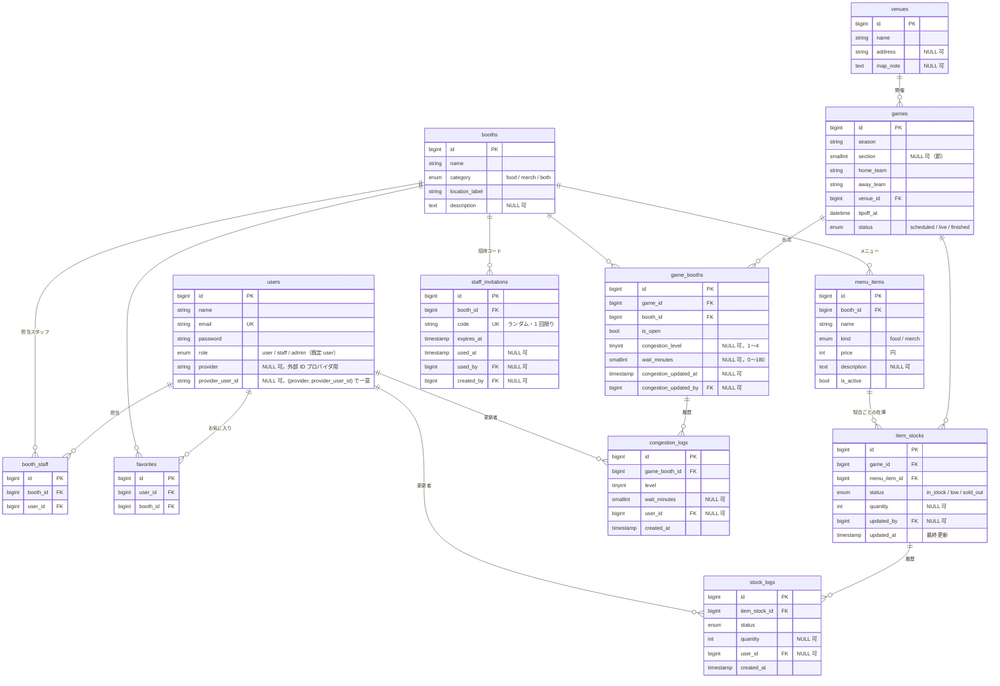

# データモデル（ER 図）

テーブルやカラムを変えたら、この図も更新する（ルールは [CLAUDE.md](../CLAUDE.md)）。マイグレーションは `backend/database/migrations/`。

## 一意制約

| テーブル | 一意 |
|---|---|
| `game_booths` | (`game_id`, `booth_id`) |
| `item_stocks` | (`game_id`, `menu_item_id`) |
| `booth_staff` | (`booth_id`, `user_id`) |
| `favorites` | (`user_id`, `booth_id`) |
| `staff_invitations` | `code` |
| `games` | (`season`, `section`, `home_team`, `away_team`)。CSV の再インポートで同じ試合を重複登録しないため |
| `users` | `email`、(`provider`, `provider_user_id`) |

> 注意: MySQL の一意制約は NULL を「互いに異なる値」として扱うため、`section` が NULL の試合は上の制約では重複を防げない。CSV 取り込み（WP-B7）ではアプリ側でも重複を確認する。

## 削除時の扱い

- 試合を消すと、その試合の `game_booths`・`item_stocks`（とその履歴）も消える。ブース・メニューは残る。会場は試合があると消せない。
- ユーザーを消しても、履歴（`congestion_logs` / `stock_logs`）と更新者の記録は残り、ユーザーの参照だけが NULL になる。
- 履歴は追記専用（`created_at` のみ）。

## 時刻

`games.tipoff_at` など日時は、アプリのタイムゾーン（`APP_TIMEZONE`、既定 `Asia/Tokyo`）の時刻で保存する。API は ISO 8601（`+09:00` 付き）で返す。
